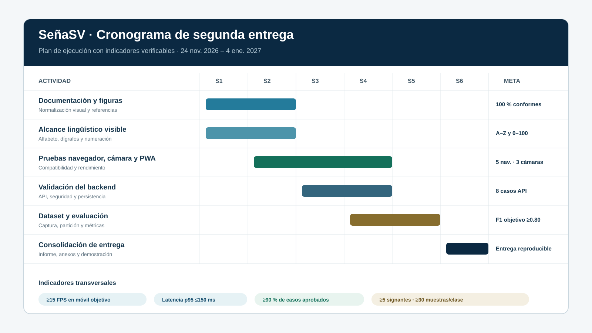

# Plan de mejoras para la segunda entrega

## 1. Propósito

Este documento transforma las observaciones de la primera entrega en actividades verificables. La segunda entrega debe mejorar la calidad visual del informe, formalizar el cronograma con métricas, ampliar la evidencia de pruebas y presentar claramente el alcance del alfabeto y la numeración.

## 2. Registro de observaciones y acciones

| Observación recibida | Acción correctiva | Evidencia esperada | Criterio de aceptación |
|---|---|---|---|
| Algunas figuras podrían tener mejor tamaño o resolución. | Sustituir capturas pequeñas por SVG o PNG de alta resolución; unificar proporción, tipografía y pies de figura. | Carpeta de figuras y documento final. | 100 % de las figuras en SVG o con ancho mínimo de 1600 px; texto legible al 100 %; título, número y fuente visibles. |
| Se esperaba un diagrama de Gantt con métricas. | Incorporar un Gantt de seis semanas con entregables, dependencias y metas cuantificables. | `docs/figures/gantt-segunda-entrega.svg`. | Todas las actividades incluyen responsable funcional, duración, indicador y meta. |
| Deben documentarse pruebas específicas de navegador, cámara y backend. | Ejecutar una matriz de compatibilidad y registrar dispositivo, versión, resultado, métrica y evidencia. | Tabla de resultados y capturas de prueba. | Cobertura mínima de 5 combinaciones de navegador/SO, 3 clases de cámara y 8 casos de API. |
| El rendimiento y la instalación PWA pueden variar por versión y hardware. | Medir FPS, latencia p50/p95, tiempo de carga, instalación y operación sin conexión. | Hoja de resultados por dispositivo. | ≥15 FPS en móvil objetivo; latencia p95 ≤150 ms; instalación exitosa en ≥3 plataformas; caché básico funcional sin conexión. |
| Debió mostrarse el alfabeto y los números que identificará el sistema. | Añadir en la página principal el catálogo de etiquetas y diferenciar alcance objetivo, reconocimiento base y clases entrenadas. | Sección “Clases contempladas por el proyecto”. | Alfabeto completo, dígrafos contemplados y rango 0–100 visibles; clases base claramente destacadas. |

## 3. Alcance lingüístico y técnico

### Alfabeto objetivo

A, B, C, CH, D, E, F, G, H, I, J, K, L, LL, M, N, Ñ, O, P, Q, R, RR, S, T, U, V, W, X, Y y Z.

El reconocimiento geométrico base cubre A, B, D, F, G, H, I, L, U, V, W y Y. Las letras restantes requieren muestras propias validadas. J y Z requieren análisis temporal por contener movimiento.

### Numeración objetivo

Valores individuales de 0 a 100. El reconocimiento geométrico base cubre 0–4; el resto se incorpora mediante entrenamiento supervisado y validación.

## 4. Matriz de pruebas

### Navegador y PWA

| ID | Plataforma | Prueba | Métricas | Meta |
|---|---|---|---|---|
| NAV-01 | Chrome / Windows | Cámara, reconocimiento, voz y almacenamiento local | FPS, p95, errores | ≥20 FPS y 0 errores críticos |
| NAV-02 | Edge / Windows | Cámara, permisos e instalación PWA | instalación, reinicio | Instalación y reapertura correctas |
| NAV-03 | Firefox / Windows | Cámara y modo web | FPS, permisos | Funcional; documentar limitaciones PWA |
| NAV-04 | Chrome / Android | Cámara frontal, orientación y PWA | FPS, p95, temperatura | ≥15 FPS; p95 ≤150 ms |
| NAV-05 | Safari / iOS | Cámara, audio y acceso desde inicio | permisos, voz, reinicio | Flujo principal sin error crítico |

### Cámara y hardware

| ID | Clase de dispositivo | Condiciones | Resultado registrado |
|---|---|---|---|
| CAM-01 | Cámara integrada de portátil | 720p, luz interior uniforme | Detección, FPS, distancia útil |
| CAM-02 | Cámara USB | 1080p, fondo claro y complejo | Detección, latencia, estabilidad |
| CAM-03 | Cámara frontal de teléfono | vertical/horizontal, luz baja/alta | orientación, FPS, consumo percibido |

### Backend

| ID | Caso | Resultado esperado |
|---|---|---|
| API-01 | `GET /api/v1/health` | HTTP 200 y estado operativo |
| API-02 | Lote válido de 1–40 muestras | HTTP 201 y cantidad aceptada |
| API-03 | Vector distinto de 126 valores | HTTP 400 |
| API-04 | Etiqueta fuera del catálogo | HTTP 400 |
| API-05 | Origen no autorizado | HTTP 403 |
| API-06 | Exceso de solicitudes | HTTP 429 |
| API-07 | Reinicio del servicio | Persistencia confirmada |
| API-08 | Consulta de resumen | Totales coherentes por etiqueta y participante |

## 5. Métricas de evaluación

- Calidad del modelo: macro-F1, precisión, exhaustividad y matriz de confusión por clase.
- Generalización: partición de entrenamiento, validación y prueba separada por signante.
- Rendimiento: FPS medio, latencia de detección e inferencia p50/p95, memoria y tiempo de carga.
- Compatibilidad: porcentaje de casos aprobados por navegador, sistema operativo y cámara.
- PWA: instalación, reapertura, actualización de service worker y funcionamiento básico sin conexión.
- Backend: tasa de lotes aceptados, rechazados, duplicados y tiempo de respuesta p50/p95.
- Dataset: participantes, muestras por clase, balance de clases y porcentaje validado manualmente.

## 6. Cronograma Gantt

La figura vectorial puede incorporarse al informe sin pérdida de resolución:

| Fase | Periodo propuesto | Indicador de cierre |
|---|---|---|
| Normalización documental y figuras | 24–30 nov. 2026 | 100 % de figuras conformes |
| Presentación del alcance lingüístico | 24 nov.–1 dic. 2026 | Alfabeto y 0–100 visibles |
| Pruebas de navegador, cámara y PWA | 1–14 dic. 2026 | 5 navegadores, 3 cámaras, ≥90 % casos aprobados |
| Pruebas y persistencia del backend | 8–18 dic. 2026 | 8 casos API aprobados |
| Dataset y evaluación del modelo | 15–28 dic. 2026 | ≥5 signantes; ≥30 muestras/clase; macro-F1 objetivo ≥0.80 |
| Consolidación de la segunda entrega | 28 dic. 2026–4 ene. 2027 | Informe, anexos y demostración reproducible |

Las fechas son una propuesta de control y deben alinearse con el calendario oficial de la asignatura.

## 7. Plantilla de evidencia

Cada prueba debe registrar: fecha, responsable, versión del navegador, sistema operativo, dispositivo, cámara, resolución, condición de iluminación, resultado, métricas, evidencia y observaciones. Un caso se considera aprobado únicamente cuando cumple su meta y no presenta errores críticos.
